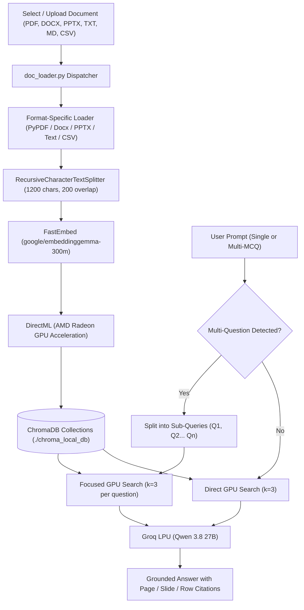

# 📚 Local RAG Multi-Document Assistant

An offline-first, GPU-accelerated **Retrieval-Augmented Generation (RAG)** assistant designed to index and query large academic documents, lecture slides, papers, notes, and datasets across multiple formats with granular citations.

Built with **LangChain**, **FastEmbed** (`EmbeddingGemma 300M` via **AMD GPU DirectML**), **ChromaDB**, and **Groq** (`Qwen 3.8 27B`).

---

## 🚀 Key Features

- **⚡ Hardware-Accelerated Offline Embeddings**: Uses Google's `EmbeddingGemma-300M` model via **FastEmbed** and **DirectML**, running locally on AMD Radeon GPU (and other DirectX 12 hardware) with **zero API rate limits** and **zero 429 quota errors**.
- **⚡ Ultra-Fast Generation**: Powered by **Groq LPU** inference running `qwen/qwen3.8-27b` for sub-second, grounded responses.
- **📂 Multi-Format Document Support**:
  - 📄 **PDF** (`.pdf`) - Streaming page-by-page extraction with page citations.
  - 📝 **Word Documents** (`.docx`) - Full text extraction with section citations.
  - 📊 **PowerPoint Slides** (`.pptx`) - Slide-by-slide extraction with slide number citations.
  - 📋 **Markdown & Text** (`.md`, `.txt`) - UTF-8 / multi-encoding tolerant parsing.
  - 📈 **Spreadsheets / CSV** (`.csv`) - Tabular row-level citations.
- **🌐 Multi-Document Federated Search (Option A)**:
  - Query **multiple documents simultaneously** or toggle **"Query ALL Indexed Documents"** with one click.
  - Queries are executed using an optimized single-pass GPU embedding across all selected Chroma collections, ranking and merging the most semantically relevant chunks into unified context.
  - Granular multi-document citations: Each answer cites the exact document title, page/slide/row, and semantic distance.
- **🎯 Dynamic Document Selection & Drag-and-Drop Upload**:
  - Multi-select documents to query directly in the **Streamlit sidebar**.
  - Drag and drop new files via the built-in file uploader.
  - Each document maintains its own isolated ChromaDB collection for clean updates and modular re-indexing.
- **🧩 Sub-Query Auto-Decomposition**: Automatically detects prompts with multiple questions/MCQs, running independent, focused vector searches ($k=3$) for each question to eliminate vector dilution and prevent token quota blowups.
- **💬 Gemini/ChatGPT-Style Web Interface**: Built with **Streamlit**, featuring:
  - `➕ New Chat` button.
  - Multi-session chat history with automatic topic naming.
  - One-click deletion of conversations.
  - Native LaTeX math rendering (`$...$` and `$$...$$`).
  - Expandable source citation drawers displaying exact document names, page/slide/row numbers, semantic scores, and retrieved context chunks.
- **👁️ Multimodal Vision Support (Qwen 3.8 27B)**:
  - Drag and drop or attach images (`.png`, `.jpg`, `.jpeg`, `.webp`) directly in the chat bar.
  - Ask questions about handwritten notes, exam diagrams, hardware charts, and lecture slides.
  - Automatic OCR & visual query extraction: If an image is dropped without prompt text, Qwen automatically inspects the visual content, formulates an optimal retrieval query, fetches relevant document context from ChromaDB, and delivers an in-depth cited answer.
- **🖥️ Dual Mode**: Run as a modern web application (`streamlit_app.py`) or an interactive terminal CLI (`app.py`).

---

## 🏗️ Architecture



---

## 🛠️ Getting Started

### 1. Prerequisites
- Python 3.10+
- A free [Groq Cloud API Key](https://console.groq.com/)

### 2. Installation

Clone this repository and set up a virtual environment:

```powershell
# Clone the repository
git clone https://github.com/rishon-arch/RAG1.git
cd RAG1

# Create and activate virtual environment
python -m venv .venv
.\.venv\Scripts\Activate.ps1   # On Windows PowerShell
# source .venv/bin/activate    # On Linux/macOS

# Install dependencies
pip install -r requirements.txt
```

### 3. Configure API Keys

Create a `.env` file in the root folder:

```env
GROQ_API_KEY=your_groq_api_key_here
```

### 4. Add Documents

Place any documents (`.pdf`, `.docx`, `.pptx`, `.txt`, `.md`, `.csv`) in the project directory or upload them directly via the Streamlit interface into `./uploaded_docs`.

---

## 💻 Usage

### Option A: Launch the Web GUI (Streamlit)

```powershell
streamlit run streamlit_app.py
```
- In the sidebar under **"📁 Document Selection"**, choose any existing document or upload a new one.
- If the document is not yet indexed, click **"🚀 Index Document Now"** to extract and embed it locally on your GPU.
- If already indexed, the database loads instantly in under a second!

### Option B: Run in the Terminal (CLI)

```powershell
# Interactive menu:
python app.py

# Or directly specify target document:
python app.py "Module 1&2 book material.pdf"
```

---

## ⚙️ GPU Acceleration Note (DirectML)

This project uses `onnxruntime-directml` for cross-vendor GPU acceleration. It works out-of-the-box on:
- **AMD Radeon™ GPUs** (RDNA 1/2/3/3.5, Integrated & Discrete)
- **Intel Arc & Iris Xe GPUs**
- **NVIDIA GeForce GPUs**

If running on CPU only, standard `onnxruntime` can be used.

---

## 📄 License
MIT License.
