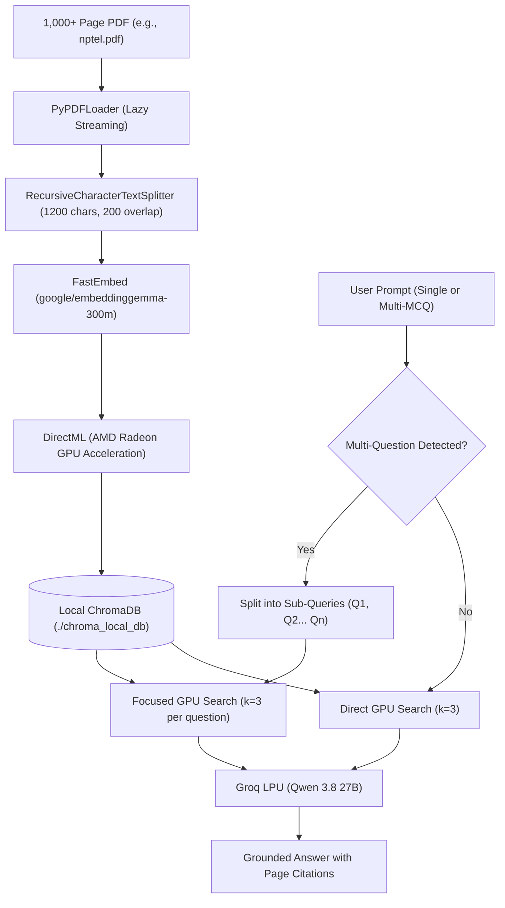

# 📚 Local RAG Course Assistant

An offline-first, GPU-accelerated **Retrieval-Augmented Generation (RAG)** assistant designed to index and query large academic documents (1,000+ pages) with page-level citations.

Built with **LangChain**, **FastEmbed** (`EmbeddingGemma 300M` via **AMD GPU DirectML**), **ChromaDB**, and **Groq** (`Qwen 3.8 27B`).

---

## 🚀 Key Features

- **⚡ Hardware-Accelerated Offline Embeddings**: Uses Google's `EmbeddingGemma-300M` model via **FastEmbed** and **DirectML**, running locally on AMD Radeon GPU (and other DirectX 12 hardware) with **zero API rate limits** and **zero 429 quota errors**.
- **⚡ Ultra-Fast Generation**: Powered by **Groq LPU** inference running `qwen/qwen3.8-27b` for sub-second, grounded responses.
- **🧩 Sub-Query Auto-Decomposition**: Automatically detects prompts with multiple questions/MCQs, running independent, focused vector searches ($k=3$) for each question to eliminate vector dilution and prevent token quota blowups.
- **💬 Gemini/ChatGPT-Style Web Interface**: Built with **Streamlit**, featuring:
  - `➕ New Chat` button.
  - Multi-session chat history with automatic topic naming.
  - One-click deletion of conversations.
  - Native LaTeX math rendering (`$...$` and `$$...$$`).
  - Expandable source citation drawers displaying exact page numbers and retrieved context chunks.
- **🖥️ Dual Mode**: Run as a modern web application (`streamlit_app.py`) or a clean terminal CLI (`app.py`).

---

## 🏗️ Architecture



---

## 🛠️ Getting Started

### 1. Prerequisites
- Python 3.10+
- A free [Groq Cloud API Key](https://console.groq.com/)

### 2. Installation

Clone this repository and set up a virtual environment:

```powershell
# Clone the repository
git clone https://github.com/rishon-arch/RAG1.git
cd RAG1

# Create and activate virtual environment
python -m venv .venv
.\.venv\Scripts\Activate.ps1   # On Windows PowerShell
# source .venv/bin/activate    # On Linux/macOS

# Install dependencies
pip install -r requirements.txt
```

### 3. Configure API Keys

Create a `.env` file in the root folder:

```env
GROQ_API_KEY=your_groq_api_key_here
```

*(Optional: `GOOGLE_API_KEY` is only needed if you choose to use Google cloud embeddings instead of local FastEmbed).*

### 4. Add Your Course PDF

Place your PDF document in the project root directory (default target: `nptel.pdf`).

---

## 💻 Usage

### Option A: Launch the Web GUI (Streamlit)

```powershell
streamlit run streamlit_app.py
```
- On the first run, click **"🚀 Index Document Now"** to extract and embed the PDF locally on your GPU.
- On all subsequent runs, the database loads instantly from disk in under a second!

### Option B: Run in the Terminal (CLI)

```powershell
python app.py
```

---

## ⚙️ GPU Acceleration Note (DirectML)

This project uses `onnxruntime-directml` for cross-vendor GPU acceleration. It works out-of-the-box on:
- **AMD Radeon™ GPUs** (RDNA 1/2/3/3.5, Integrated & Discrete)
- **Intel Arc & Iris Xe GPUs**
- **NVIDIA GeForce GPUs**

If running on CPU only, standard `onnxruntime` can be used.

---

## 📄 License
MIT License.
